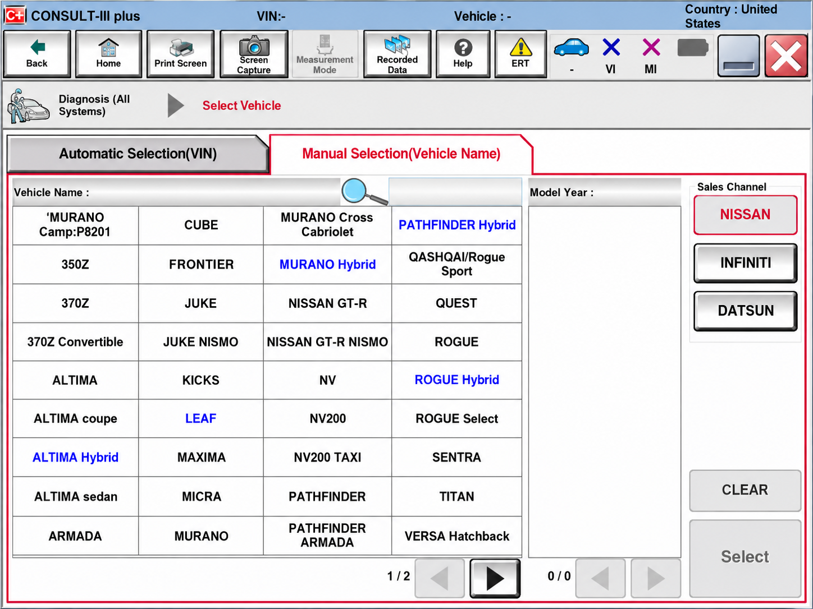
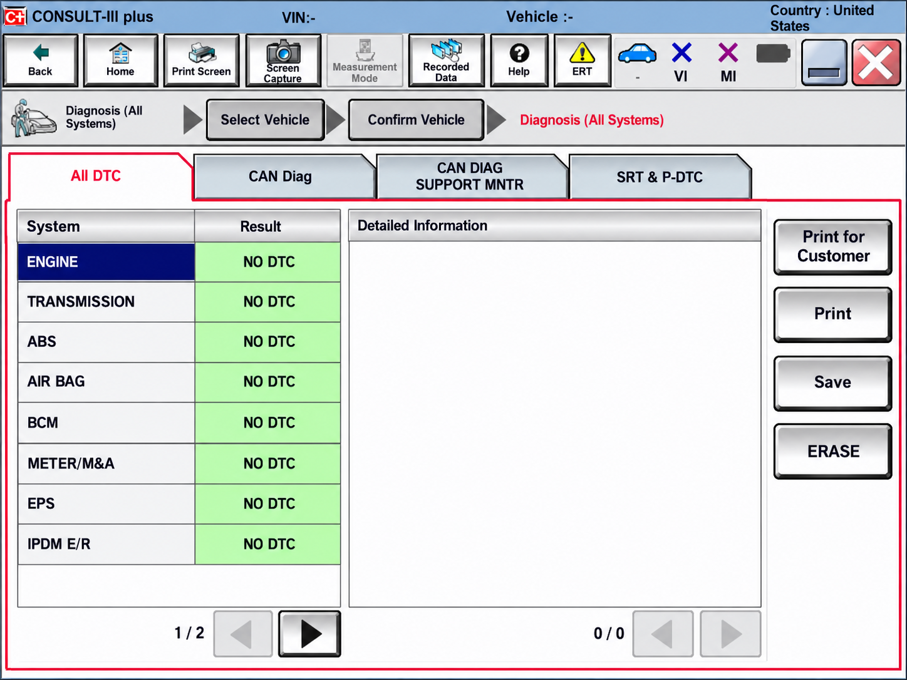
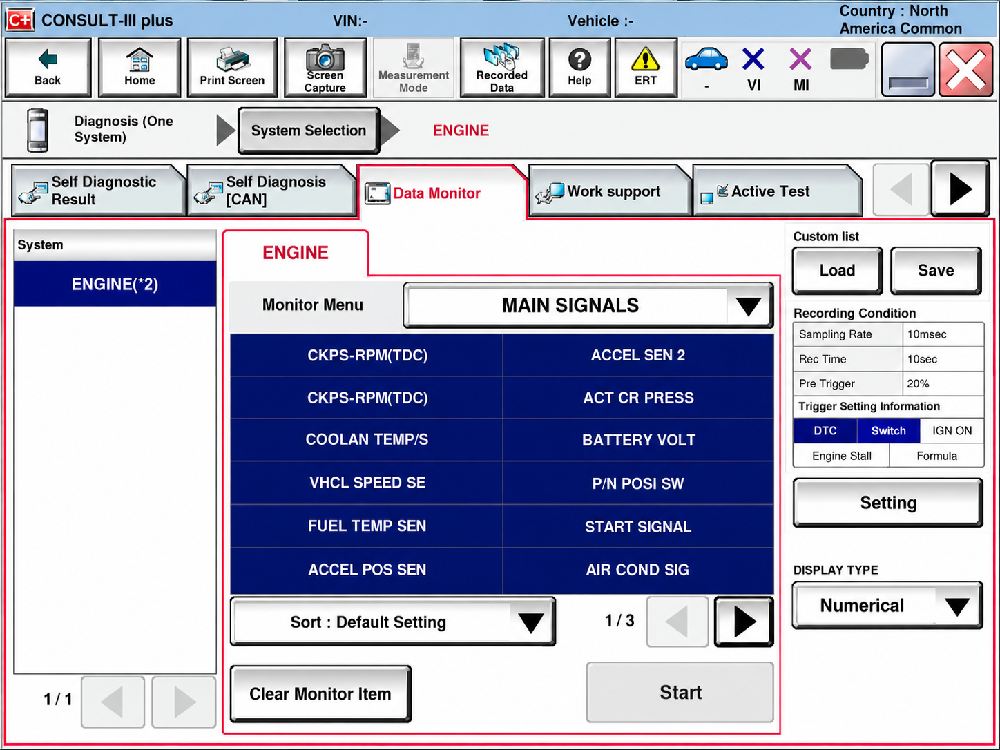

# Nissan Consult 3 Plus J2534 - Python UDS Diagnostics And Pass-Thru Support

Nissan Consult 3 Plus J2534 is a Python-based vehicle diagnostics foundation for UDS communication through SAE J2534 pass-through interfaces. The Nissan Consult 3 Plus organization provides protocol services, request handling, diagnostic responses, and automated tests related to Nissan and Infiniti diagnostic workflows.

## Features (Current)

- SAE J2534 pass-through integration.
- Unified Diagnostic Services request and response handling.
- Diagnostic session control and ECU reset services.
- Diagnostic Trouble Code reading and clearing.
- Data identifier and memory access operations.
- Security access, authentication, and communication control.
- Request download, upload, transfer, and file-transfer services.
- Routine control and tester-present handling.
- Typed Python interfaces and automated protocol tests.



### Diagnostic Scope

nissan consult 3 plus, nissan consult 3 plus j2534, nissan consult 3 plus software, nissan consult 3 plus interface, nissan consult 3 plus reprogramming, nissan consult 3 plus supported vehicles, nissan, infiniti, vehicle-diagnostics, automotive-diagnostics, j2534, ecu-programming, obd2, can-bus

## Diagnostic adapter API Support

- **SAE J2534:** The primary pass-through API represented by [udsoncan/j2534.py](udsoncan/j2534.py).
- **UDS:** Diagnostic requests, responses, services, timing, and error handling.
- **Transport connections:** Connection abstractions are defined in [udsoncan/connections.py](udsoncan/connections.py).
- **OEM interfaces:** A Nissan Consult 3 Plus vehicle interface, Nissan VI2, Nissan Alliance VI2, or another compatible pass-through device still requires its appropriate vendor driver.

Commercial J2534 devices commonly provide Windows drivers. Compatibility with a Nissan Consult 3 Plus VI2 interface, Nissan Consult 3 OpenPort 2.0 configuration, or other Nissan Consult 3 interface depends on the installed driver and the capabilities exposed by that device.

## Platform support

| OS | Adapter support | Note |
|---|---|---|
| Windows | Vendor-supported J2534 interfaces | The normal environment for Nissan Consult 3 Plus J2534 and OEM pass-through drivers. |
| Linux | Core protocol development and tests | Commercial Nissan Consult J2534 drivers may not be available. |
| macOS | Core protocol development and tests | Hardware access depends on a compatible driver and connection implementation. |

[](https://nissan-consult-3-plus.github.io/nissan-consult-3-plus-j2534/consult-3-plus)

### What is Nissan Consult 3?

Nissan Consult 3 is the name commonly used for Nissan’s dealership diagnostic platform, while Nissan Consult 3 Plus is the newer application used for Nissan and Infiniti diagnostics, coding, configuration, and programming. Search terms such as Nissan Consult3, Consult III, Nissan Consult III Plus, and Consult 3 Plus frequently refer to related generations or spellings.

Nissan Consult 3 Plus J2534 is the repository name for this protocol-focused implementation.

## Software

Nissan Consult 3 Plus diagnostic software combines an OEM application, vehicle-specific data, a supported Nissan Consult 3 Plus interface, and any required subscription or authorization. Nissan Consult 3 Plus J2534 focuses on the Python UDS and pass-through communication components.

The package metadata is defined in [pyproject.toml](pyproject.toml), [setup.cfg](setup.cfg), and [setup.py](setup.py). Runtime requirements are listed in [requirements.txt](requirements.txt), while release information is maintained in [RELEASES.md](RELEASES.md).

### How much does Nissan Consult 3+ cost?

There is no single Nissan Consult 3 Plus price represented by this repository. Official costs can vary by region, subscription duration, dealership or independent-repair access, supported functions, and whether Nissan Consult 3 Plus programming software or Nissan Consult 3 Plus R2R software is required.

Hardware is normally separate. A Nissan Consult VI, Nissan VI2, Nissan Consult 3 cable, Nissan Consult 3 Plus VI2 interface, or compatible J2534 device may add its own purchase and driver costs. Nissan Consult 3 Plus subscription cost can also be separate from calibration access and professional service charges.

Nissan Consult 3 Plus J2534 source usage is governed by [LICENSE](LICENSE).

### What Nissan diagnostic software can I download and install on my PC?

The official choice is the Nissan Consult 3 Plus software supplied through Nissan’s authorized technical-information channel for the user’s market. Installation requirements depend on the current Nissan Consult 3 Plus system requirements, supported vehicles, subscription terms, Windows version, and approved vehicle interface.

Nissan Consult 3 Plus J2534 can be installed from a local source checkout as a Python package for protocol development and testing.

Users should avoid unofficial Nissan Consult 3 Plus software packages that modify licensing, request unknown administrator credentials, or bundle unverified drivers. Diagnostic and programming work should use authorized software, trusted interfaces, and the correct service information for the exact vehicle year and model.

## SAE J2534

SAE J2534 defines communication between a PC application and a vehicle through a pass-through device. Nissan Consult 3 Plus J2534 uses this architecture to separate UDS diagnostic logic from the physical Nissan Consult 3 Plus vehicle interface.



The J2534 layer is represented by [udsoncan/j2534.py](udsoncan/j2534.py). Requests and responses are modeled by [udsoncan/Request.py](udsoncan/Request.py), [udsoncan/Response.py](udsoncan/Response.py), and [udsoncan/ResponseCode.py](udsoncan/ResponseCode.py).

A typical path is:

1. Nissan Consult 3 Plus J2534 creates a diagnostic request.
2. The connection layer sends it through the configured Nissan Consult J2534 interface.
3. The interface exchanges frames with the selected ECU.
4. Nissan Consult 3 Plus J2534 parses the ECU response.
5. The client reports positive responses, negative response codes, or transport errors.

## Quick start

Create an isolated Python environment, install the local project, and run the test suite:

```shell
python -m venv .venv
python -m pip install -e .
python -m pytest
```

The complete client behavior is exercised by [test/client/test_client.py](test/client/test_client.py). J2534 hardware must have a working vendor driver before Nissan Consult 3 Plus J2534 can open the pass-through interface.

## Project Structure

- [`udsoncan/client.py`](udsoncan/client.py) provides the high-level diagnostic client.
- [`udsoncan/connections.py`](udsoncan/connections.py) defines transport connection behavior.
- [`udsoncan/j2534.py`](udsoncan/j2534.py) contains Nissan Consult 3 Plus J2534 pass-through integration.
- [`udsoncan/configs.py`](udsoncan/configs.py) contains client configuration support.
- [`udsoncan/exceptions.py`](udsoncan/exceptions.py) defines communication and protocol errors.
- [`udsoncan/common/`](udsoncan/common/__init__.py) contains diagnostic data types and codecs.
- [`udsoncan/services/`](udsoncan/services/__init__.py) contains modular UDS service implementations.
- [`test/client/`](test/client/__init__.py) contains service-level client tests.
- [`test/UdsTest.py`](test/UdsTest.py) covers shared UDS test behavior.
- [`test/TransportLayerBaseTest.py`](test/TransportLayerBaseTest.py) covers transport-layer behavior.

## Python API

Nissan Consult 3 Plus J2534 separates the client, connection, request, response, and service layers. This modular design allows a diagnostic workflow to select a connection and invoke only the UDS services required by the target ECU.

Core building blocks include:

```python
from udsoncan.client import Client
from udsoncan import Request, Response
from udsoncan import services
```

Service implementations include:

- [DiagnosticSessionControl](udsoncan/services/DiagnosticSessionControl.py)
- [ECUReset](udsoncan/services/ECUReset.py)
- [ReadDataByIdentifier](udsoncan/services/ReadDataByIdentifier.py)
- [ReadDTCInformation](udsoncan/services/ReadDTCInformation.py)
- [ClearDiagnosticInformation](udsoncan/services/ClearDiagnosticInformation.py)
- [RoutineControl](udsoncan/services/RoutineControl.py)
- [SecurityAccess](udsoncan/services/SecurityAccess.py)
- [RequestDownload](udsoncan/services/RequestDownload.py)
- [TransferData](udsoncan/services/TransferData.py)
- [RequestTransferExit](udsoncan/services/RequestTransferExit.py)

Nissan Consult 3 Plus module coding, Nissan Consult 3 Plus ECM programming, and Nissan Consult 3 Plus ECU programming require vehicle-specific procedures beyond these generic service definitions.

## Reprogramming & Tuning

Nissan Consult 3 Plus reprogramming normally involves selecting an ECU, confirming battery support, identifying the current software, obtaining an authorized calibration, entering the required diagnostic session, transferring data, validating the result, and safely resetting the module.

The underlying UDS sequence can involve [DiagnosticSessionControl](udsoncan/services/DiagnosticSessionControl.py), [SecurityAccess](udsoncan/services/SecurityAccess.py), [RequestDownload](udsoncan/services/RequestDownload.py), [TransferData](udsoncan/services/TransferData.py), and [RequestTransferExit](udsoncan/services/RequestTransferExit.py).

### How much does it cost to reprogram the ECM in a Nissan vehicle?

The cost depends on the vehicle year and model, ECM condition, required calibration, labor rate, Nissan Consult 3 Plus subscription, and whether diagnosis or module replacement is also needed. This repository cannot provide a fixed price because it does not sell Nissan Consult 3 Plus programming access or dealership service.

A shop may need to account for technician time, a Nissan Consult 3 Plus interface or compatible pass-through device, software access, calibration access, and a stable programming power supply. Additional coding, immobilizer work, or Nissan Consult 3 Plus key programming can change the total.

An interrupted ECM update can leave the controller unusable. Users should obtain a vehicle-specific quote and confirm that the provider uses authorized Nissan Consult 3 Plus programming software and the correct calibration for the VIN.

## Protocols

Nissan Consult 3 Plus J2534 models UDS services commonly transported over ISO-TP and CAN. Supported service definitions include timing access, authentication, communication control, DTC control, dynamic identifiers, memory access, file transfer, secured transmission, and tester-present messages.

Diagnostic data helpers include [DidCodec](udsoncan/common/DidCodec.py), [MemoryLocation](udsoncan/common/MemoryLocation.py), [DataFormatIdentifier](udsoncan/common/DataFormatIdentifier.py), and [AddressAndLengthFormatIdentifier](udsoncan/common/AddressAndLengthFormatIdentifier.py).

## Testing OBD-II applications

The repository includes automated tests for diagnostic sessions, authentication, DTC operations, ECU resets, memory access, transfer operations, and routine control.



Representative tests include:

- [test_diagnostic_session_control.py](test/client/test_diagnostic_session_control.py)
- [test_read_dtc_information.py](test/client/test_read_dtc_information.py)
- [test_security_access.py](test/client/test_security_access.py)
- [test_request_download.py](test/client/test_request_download.py)
- [test_transfer_data.py](test/client/test_transfer_data.py)
- [test_write_data_by_identifier.py](test/client/test_write_data_by_identifier.py)

The automated workflows are defined in [.github/workflows/tests.yml](.github/workflows/tests.yml) and [.github/workflows/python-syntax-checker.yml](.github/workflows/python-syntax-checker.yml).

## Compatibility

Nissan Consult 3 Plus supported vehicles vary by software release, market, model year, ECU, and subscription. Compatibility cannot be inferred only from the presence of an OBD-II connector or a J2534 driver.

Before using Nissan Consult 3 Plus J2534, verify:

- The exact Nissan or Infiniti year, model, powertrain, and ECU.
- The required diagnostic protocol and addressing.
- The Nissan Consult 3 Plus interface driver.
- The J2534 API version exposed by the adapter.
- The authorized calibration and programming prerequisites.
- The availability of stable vehicle and PC power.

## Safety Model

> Diagnostic commands can alter ECU state, clear evidence needed for repair, disable communication, or interrupt programming.

Use Nissan Consult 3 Plus J2534 on a bench or stationary vehicle until the workflow has been validated. Do not send unverified requests to safety-critical modules. Preserve DTCs and identification data before clearing faults, and never program an ECU without stable power and a recovery plan.

## Standards

Nissan Consult 3 Plus J2534 is organized around these diagnostic concepts:

- SAE J2534 pass-through communication.
- Unified Diagnostic Services.
- ISO-TP transport over CAN.
- Diagnostic Trouble Codes.
- OBD-II vehicle diagnostics.
- ECU programming and data transfer.

## Contributing

Contributions should include focused code changes, tests, and clear descriptions of the affected service or transport behavior. Read [CONTRIBUTING.md](CONTRIBUTING.md) before submitting changes.

Security-sensitive findings involving Nissan Consult 3 Plus J2534, authentication, or programming behavior should follow [SECURITY.md](SECURITY.md). Changes should preserve the separation between generic protocol support and proprietary Nissan Consult 3 Plus software or vehicle data.

## License

See [LICENSE](LICENSE).
